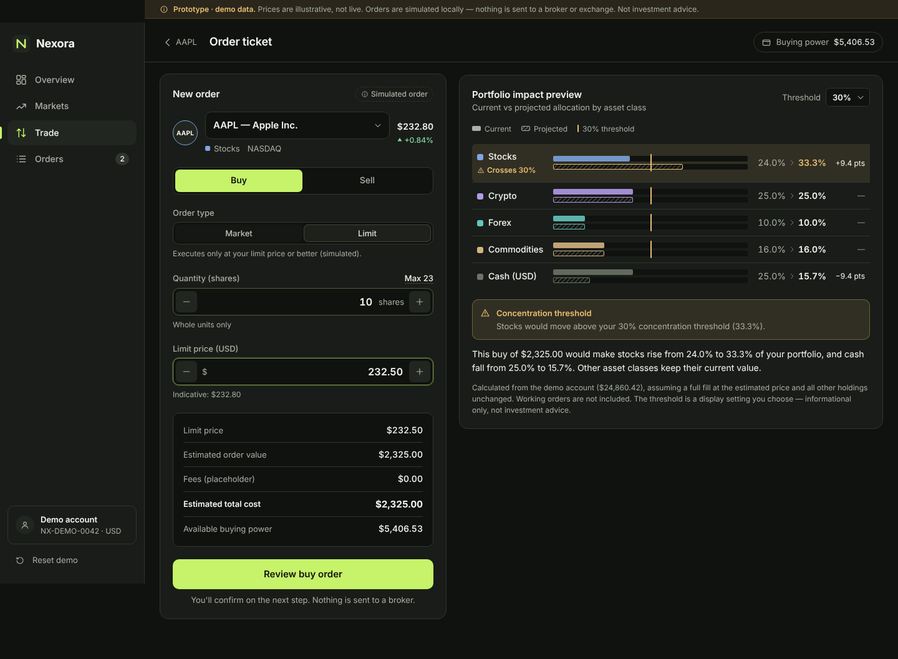
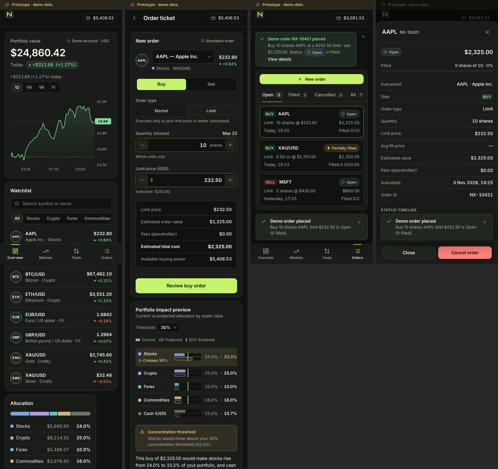

# Nexora — Multi-Asset Trading UI Prototype

A responsive front-end prototype for **Nexora**, a dark-mode, multi-asset trading platform (stocks, crypto, forex, commodities). Its main feature is a **portfolio impact preview** inside the order flow. The preview compares current and projected allocation, flags when a configurable concentration threshold is crossed, and explains the change in plain language.

> **Demo only.** All prices and account data are illustrative. Orders are simulated in the browser and stored in `localStorage`. Nothing connects to a broker, exchange, payment provider or market-data API. Nothing here is investment advice.



## Run it

```bash
npm install
npm run dev        # http://localhost:5173
npm run build      # typecheck + production build to dist/
npm run preview    # serve the build
```

The app uses hash routing and a relative `base`, so you can deploy `dist/` to any static host.

## Screens

| Route | Screen |
| --- | --- |
| `#/overview` | Portfolio value, daily P&L, performance chart (1D/1W/1M/1Y), allocation, watchlist with class filter and search, open orders, recent activity |
| `#/asset/AAPL` | Instrument header, indicative price, candle/line chart (1H–1Y), key stats, your position, simulated market depth, Buy/Sell |
| `#/trade/AAPL?side=buy` | Order ticket (Buy/Sell, Market/Limit, quantity, limit price, estimate, fee placeholder, buying power) with a live impact preview. A review step comes before submission |
| `#/orders` | Open / Filled / Cancelled / All tabs, order details drawer, fill progress, status timeline, cancel with confirmation |

## Demo walkthrough

1. On **Overview**, select **AAPL**.
2. On **Asset Details**, choose **Buy AAPL**.
3. On the **Order ticket**, switch to **Limit** and enter **10** shares at **232.50**. The ticket shows an estimated value of **$2,325.00** before fees.
4. The impact preview shows stocks rising from **24.0% to 33.3%** of the portfolio, which crosses the default **30%** threshold. Cash falls from 25.0% to 15.7%. Change the threshold from the dropdown.
5. Select **Review buy order**, then **Submit demo buy order**.
6. You land on **Orders**, where a confirmation banner shows the AAPL order as **Open (0 filled)**.
7. Open the order to see its details and timeline. Select **Cancel order**, then confirm.

To test validation, try an empty, `0`, negative or `99999` quantity, a fractional share, or `40` shares, which exceeds buying power. Selling more than you hold or have available is also blocked. **Reset demo** in the sidebar restores the starting data.

## Data model (internally consistent)

The account totals **$24,860.42**, with today's P&L of **+$312.68 (+1.27%)**. Holdings are quantity × indicative price, and cash is the remainder:

| Class | Holdings | Value | Share |
| --- | --- | --- | --- |
| Stocks | 15 AAPL, 6 MSFT | $5,965.80 | 24.0% |
| Crypto | 0.0721 BTC, 0.38 ETH | $6,214.92 | 25.0% |
| Forex | 2,293 EUR | $2,486.07 | 10.0% |
| Commodities | 1.2 oz gold, 21 oz silver | $3,976.80 | 16.0% |
| Cash (USD) | — | $6,216.83 | 25.0% |

Buying power is cash minus the amount reserved by working buy orders ($5,406.53 at the start). The impact projection assumes a full fill at the estimated price, with every other holding unchanged. Buying moves value from cash into the asset class; selling does the reverse.

The brief's crypto example falls out of the same calculation. Buying **0.0258 BTC** (≈ $1,741) moves crypto from **25.0% to 32.0%**, crossing the 30% threshold.

## Structure

```
src/
  data/mock.ts            instruments, holdings, seed orders (illustrative)
  lib/portfolio.ts        allocation, buying power, impact projection
  lib/series.ts           deterministic chart data, market depth
  lib/store.tsx           orders/threshold state (React context + reducer, localStorage)
  lib/format.ts           currency / % / quantity / timestamp formatting
  lib/router.ts           tiny hash router
  components/ui.tsx       Button, Segmented, Tabs, Field, NumberInput, Select, PriceChange,
                          StatusBadge, Card, EmptyState, Skeleton, Notice, Modal, KeyValues
  components/charts.tsx   PriceChart (line + candles, crosshair), Sparkline, AllocationBar
  components/trading.tsx  Watchlist, ImpactPreview, OrdersTable, OrderCards, OrderTimeline
  components/layout.tsx   Sidebar, TopBar, BottomNav, DemoBanner, Toasts
  screens/                Overview, AssetDetails, OrderTicket, Orders
  styles/tokens.css       design tokens (colour, type, spacing, radii)
  styles/app.css          component + layout styles, breakpoints
```

## Responsive behaviour

- **Desktop (≥ 1024px):** persistent sidebar and multi-column layouts. The impact preview stays sticky beside the ticket.
- **Tablet (768–1023px):** an icon-only sidebar. Content reflows to one or two columns.
- **Mobile (< 768px):** compact header and bottom navigation. The watchlist becomes cards, and orders become cards instead of a table. Asset Details has a sticky Buy/Sell bar, and the ticket has a sticky Review button. Dialogs open as bottom sheets. While a text field has focus, fixed bars hide so the keyboard never covers the input.

Status is never shown by colour alone: price changes carry an arrow and a sign, order statuses have an icon and a label, and threshold breaches have an icon and text.


